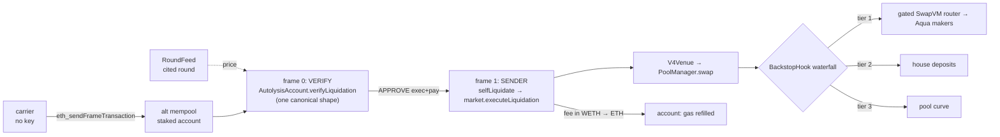

# Autolysis

[](https://github.com/jmakwana0x1/autolysis/actions/workflows/ci.yml?query=branch%3Amain)

**Self-liquidating lending.** A position liquidates itself: a keyless frame transaction (EIP-8141) that
the borrower's own `AutolysisAccount` validates and pays for, carried by the alternative mempool, sells a
slice of collateral through a Uniswap v4 pool whose hook fills from 1inch Aqua makers first, then the
house's deposits, then the curve. No liquidator, no auction, and no liquidation bonus taken from the
borrower.

> Status labels used everywhere: **on devnet** · **on fork** · **local test** · **mock only** ·
> **written, not run**. The full per-item table is [`docs/STATUS.md`](docs/STATUS.md).

## The problem, with numbers

A classic lending market pays a third party to liquidate an unhealthy position. That party earns a
**liquidation bonus**, typically 5–10% of the debt repaid, taken from the borrower's collateral. It also
waits until the position is far enough underwater for the bonus to cover its gas and risk. The borrower
loses the bonus on every liquidation.

Autolysis removes the third party. The position's own account approves exactly one transaction shape
(`verifyLiquidation`), anyone can broadcast it without a key, and the account pays the gas out of the
collateral being sold. The cost to the borrower is the sale's haircut against the oracle price (zero
when tier 1 or tier 2 fills, since both price at the cited round), plus a gas fee capped at
`min(MAX_COST, 0.3% of collateral sold)`.

### Net cost per liquidation (**local test**, `just demo-local`)

The first liquidation from `just gate-a-local` (anvil, frame RPCs mocked; the dashboard's "Net saved"
panel computes this live):

| | Classic (5% bonus, D1 rate) | Autolysis |
| --- | ---: | ---: |
| Debt repaid | 0.0563 USDC | 0.0563 USDC |
| Bonus paid by the borrower | 0.0028 USDC | 0 |
| Sale haircut vs cited price (tier 2 fill) | n/a | 0.0000 USDC |
| Gas, billed in collateral to the account | paid by the liquidator out of the bonus | 0.000169 USDC |
| **Borrower's cost** | **0.0028 USDC (5.0%)** | **0.000169 USDC (0.3%)** |

Health factor 0.960 → 1.055 in one gradual step (collateral 0.100 → 0.069 WETH, debt 0.150 → 0.094
USDC). The same figures on the devnet are produced by `just gate-a`: <!-- EXPLORER: gate-a --> **TBD:
devnet explorer link**.

## How one liquidation flows



The canonical mempool rejects the same transaction when VERIFY reads the market (`StorageReadNonSender`
in the workshop's step 6). The alt mempool admits it because the account is **staked** (0.012 ETH in the
devnet's `NaiveStakingRegistry`). The exact texts from each are recorded per run in
`deployments/<chainId>.json` and shown on the dashboard.

## Sponsor tracks: where to look

| Track | What | Where (file:line) | Proof | Label |
| --- | --- | --- | --- | --- |
| **EF: alt mempool** | VERIFY approves exactly one tx shape per (position, step) | `src/core/AutolysisAccount.sol:124`, `src/libraries/FirewallRules.sol:65` | `test/fuzz/FirewallRules.t.sol` (single-field mutation fuzz) | local test |
| | fixed-size frame read (15 opcode reads), shared by devnet + mock | `src/frame/CanonicalReader.sol:18`, `src/frame/FrameTypes.sol:51`, `src/frame/HegotaFrameEnv.sol:16` | `test/scenarios/A1_verify_gas.t.sol`: 71,822 / 50,414 gas | mock only |
| | never-revert SENDER envelope, self-paid from collateral | `src/core/AutolysisAccount.sol:162`, `src/core/AutolysisMarket.sol:181` | `test/integration/Liquidation.t.sol` | local test |
| | canonical frame-tx builder; simulate on the raw 0x06 bytes; VERIFY path choice | `kit/src/frameTx.ts:64`, `kit/src/sim.ts:43`, `kit/src/sim.ts:79` | `kit/test/probes.test.ts` | local test |
| | Phase A in one idempotent command | `kit/src/gateA/gateA.ts:101` (`just gate-a`) | `kit/test/gateA.test.ts`; `just gate-a-local` | local test; devnet **written, not run** |
| | Phase B scenes: crash ×12, replacement, 5 attacks, reputation | `kit/src/scenes/phaseB.ts:170`, `:225`, `:290`, `:382` | `kit/test/scenes.test.ts` | local test; devnet **written, not run** |
| | EXO-010 reputation proposal, simulated | `kit/src/sim/exo010.ts:63` | `kit/test/exo010.test.ts`; dashboard chart | local test |
| **Uniswap v4** | three-tier backstop hook; outside swappers see a normal pool | `src/backstop/BackstopHook.sol:138`, `:179` | `test/backstop/BackstopHook.t.sol` | local test |
| | settle-before-swap venue; cited-round price for the pricer | `src/backstop/V4Venue.sol:94`, `:67` | `test/integration/V4Liquidation.t.sol:138` | local test |
| | hook mined against the **official predeployed PoolManager** `0x6bF9…9848` | `script/Deploy.s.sol:47`, `:172` | `just gate-a` → `just scene uniswap-balances` | **written, not run** |
| **1inch Aqua / SwapVM** | gated router: `LiquidationGate` opcode `0xf9` | `aqua-fork/src/AutolysisAquaRouterGated.sol:46` | `aqua-fork/test/GatedAquaFill.t.sol` | local test |
| | oracle pricer (Extruction), quote == fill | `aqua-fork/src/LiquidationPricer.sol:43` | `aqua-fork/test/OraclePricedFill.t.sol` | local test |
| | hook tier 1 → gated router as taker, across solc 0.8.26/0.8.30 | `src/backstop/BackstopHook.sol:245`, `:264`, `src/interfaces/ISwapVMRouter.sol:14` | `test/integration/C1_SwapVMTier1.t.sol:191` | local test |
| | the same against the **official Aqua** `0x1111…a90a` on a Unichain fork | `test/fork/C2_OfficialAqua.t.sol:11` (`just fork-c2`) | trace `deployments/c2-fork-trace.txt` (block 63,190,327) | **on fork** |

Explorer links per environment: devnet <!-- EXPLORER: devnet --> **TBD** · Unichain fork: n/a (local
fork, trace committed) · local: n/a.

## Integrating another market: `ISelfLiquidatingMarket`

The account drives any market that implements three functions
(`src/interfaces/ISelfLiquidatingMarket.sol:7`):

```solidity
function executeLiquidation(uint256 positionId, uint256 roundId, uint256 feeCap)
    external returns (uint256 debtRepaid, uint256 collateralSold, uint256 feeBilled);
function healthFactor(uint256 positionId) external view returns (uint256);
function liquidationCount(uint256 positionId) external view returns (uint256);
```

A market that wants self-liquidation must:
1. accept `executeLiquidation` only from its account;
2. price only from the round it is given, rejecting out-of-band or stale rounds;
3. bill gas from the position's own collateral, never above `feeCap` (the transaction's `MAX_COST`);
4. key each position's liquidations by `H(market, positionId)` with the top byte cleared, so every
   position has its own nonce lane and pending liquidations never block each other.

`markUnhealthy` / `classicLiquidate` (the D1 lender fallback) are market-side and not part of the
interface.

## Commands

```bash
just setup && just test && just aqua   # local suites (Foundry 104 + aqua 9) ; just invariants for stateful
just gate-a                            # Phase A on the devnet, one unattended idempotent run
just e2e                               # Phase B: reputation, crash, replace, attacks, uniswap-balances
just fork-c2                           # C2 on a Unichain fork against the official Aqua
just demo-local                        # everything on anvil + a mock frame node, then the dashboard
just dashboard                         # dashboard on http://127.0.0.1:5173 for CHAIN_ID via RPC_URL
```

Toolchain: Foundry ≥ 1.8 (`isolate = false` is pinned in `foundry.toml`), solc 0.8.26 (main) and 0.8.30
(aqua fork, `out-aqua/`), Node 22, `just`. Keys come from `.env` (devnet-only, never committed).

## Verify it yourself

Every push to `main` runs [CI](https://github.com/jmakwana0x1/autolysis/actions/workflows/ci.yml?query=branch%3Amain)
([latest run](https://github.com/jmakwana0x1/autolysis/actions/workflows/ci.yml?query=branch%3Amain)) with
forge 1.8.1, no keys and no devnet. What each job proves:

| Job | Runs | Proves |
| --- | --- | --- |
| `contracts` | `just test`; invariants under `FOUNDRY_PROFILE=ci`; `forge test --gas-report` (artifact `gas-report`) | the firewall approves one shape per (position, step) under single-field mutation fuzzing; liquidation math never lowers HF and matches the kit to the wei; the never-revert envelope; v4 hook + venue liquidation (C1: hook tier 1 through the real gated SwapVM router + Aqua); D1 fallback; collateral/debt conservation and "classic never preempts self-liquidation" as stateful invariants |
| `aqua` | `just aqua` | the gated SwapVM/Aqua fork (solc 0.8.30): `LiquidationGate` blocks strangers and inactive venues; the oracle pricer's quote equals its fill |
| `kit` | `tsc --noEmit` + `vitest` | the frame-tx builder round-trips through the real hegota-support encoder; simulate is sent the raw 0x06 bytes; `just gate-a` and the Phase B scenes behave as specified against a mocked RPC (stop on first error, idempotent rerun, replacement, attack rejection); the EXO-010 simulator |
| `fork-unichain` | `scripts/ci/fork-c2.sh` | C2: the same liquidation flow fills through the **official** Aqua `0x1111…a90a` on a Unichain mainnet fork pinned to block 63,190,327 (trace artifact `c2-fork-trace`). A public-RPC rate limit is retried once and, if it persists, reported in the job summary |

Not in CI, by design: anything that needs devnet ETH or a private key (`just gate-a`, `just e2e`).

## Limitations (honest list)

- **Nothing has run on the devnet yet.** The deploy keys are unfunded (the faucet said "The faucet is
  empty"). Every devnet line above is **written, not run** until `just gate-a` passes.
- **VERIFY gas is mock-measured.** 71,822 (outside reads) / 50,414 (storage-only) on a cost-realistic mock.
  `just gate-a` measures both with `ethrex_simulateFrameTransaction` and picks the path by the rule.
- **The storage-only snapshot is a separate transaction** (`pushVerifySnapshot`), not yet written by the
  price push itself.
- **Tokens on the devnet are ours.** The devnet's USDC is deployer-mint only and WETH9 has no premint,
  so the pool pairs our ETH-backed MockWETH with MockUSDC on the official PoolManager.
- **Aqua runs on a fork, not the devnet.** Tier 1 fills against the official Aqua on Unichain (C2); on the
  devnet, tier 1 is empty until C3 deploys Aqua there.
- **Live-only assumptions, still to confirm:** keyed (EIP-8250) txs being exempt from the per-sender
  cap of 4 (from the sidecar's docs), and same-key fee-bump replacement winning a 6-second block race
  (`just scene replace` records whichever happens).
- **The classic fallback needs a keeper** to call `markUnhealthy` each round; without one it stays closed.
- **The net-saved figure is a model**: a 5% bonus against haircut plus gas, one collateral, no MEV.
- **D2 (vault shares for house deposits) is not built.** The house tier is a single owner's deposits.
- **The dashboard's server is local-only** (127.0.0.1) and uses the operator's `.env` key for the crash button.

## Repository history

This repository was restored after the original was accidentally deleted. The commits were replayed in
their original order, so their timestamps show the restore rather than when each change was first
written.

## More

[`docs/DESIGN.md`](docs/DESIGN.md) design and threat model · [`docs/DEVNET.md`](docs/DEVNET.md) devnet
facts (from vendored sources) · [`docs/PLAN-v4.4.md`](docs/PLAN-v4.4.md) plan ·
[`docs/FEEDBACK.md`](docs/FEEDBACK.md) Uniswap feedback · [`docs/EF_WRITEUP.md`](docs/EF_WRITEUP.md)
EF write-up · [`docs/AI_USAGE.md`](docs/AI_USAGE.md) AI usage
