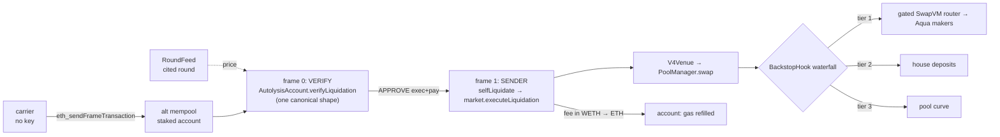

# Autolysis

[](https://github.com/jmakwana0x1/autolysis/actions/workflows/ci.yml?query=branch%3Amain)

**Self-liquidating lending.** A position liquidates itself: a keyless frame transaction (EIP-8141) that
the borrower's own `AutolysisAccount` validates and pays for, carried by the alternative mempool, sells a
slice of collateral through a Uniswap v4 pool whose hook fills from 1inch Aqua makers first, then the
house's deposits, then the curve. No privileged keeper and no liquidation bonus taken from the
borrower.

> Status labels used everywhere: **on devnet** · **on fork** · **local test** · **mock only** ·
> **written, not run**. The full per-item table is [`docs/STATUS.md`](docs/STATUS.md).

## The problem, with numbers

A classic lending market pays a third party to liquidate an unhealthy position. That party earns a
**liquidation bonus**, typically 5–10% of the debt repaid, taken from the borrower's collateral. It also
waits until the position is far enough underwater for the bonus to cover its gas and risk. The borrower
loses the bonus on every liquidation.

Autolysis removes the third party. The position's own account approves exactly one transaction shape
(`verifyLiquidation`), anyone can broadcast it without a key, and the account pays the gas out of the
collateral being sold. The cost to the borrower is the sale's haircut against the oracle price (zero
when tier 1 or tier 2 fills, since both price at the cited round), plus a gas fee capped at
`min(MAX_COST, 0.3% of collateral sold)`.

### Net cost per liquidation

One liquidation of a 150-USDC loan (HF 0.864), in the same units as the fork proof below:

| | Classic (5% bonus, the D1 rate) | Autolysis |
| --- | ---: | ---: |
| Debt repaid | 116.2587 USDC | 116.2587 USDC |
| Bonus paid by the borrower | 5.8129 USDC | 0 |
| Sale haircut vs the cited price (71.9090 COL at 1.62 = 116.4926) | n/a | 0.2339 USDC |
| Gas, billed in collateral to the account (`min(MAX_COST, 0.3% sold)`) | paid by the liquidator out of the bonus | 0.0073 USDC |
| **Borrower's cost** | **5.8129 USDC (5.0%)** | **0.2412 USDC (0.21%)** |

Sources:
- **The sale** is `just fork-uniswap` (**on fork**, the official Uniswap v4 PoolManager): tier 2 (house)
  plus tier 3 (the official pool's curve, 0.30% fee tier). The haircut is the curve's fee and slippage on the
  tier-3 part.
- **The gas line** is the devnet's simulated `MAX_COST` for the liquidation (0.004524 ETH, **on devnet**),
  priced at 1.62.

The live devnet liquidation in block 2865 shows the same mechanics on chain:
[0x913762f6…fe56](https://explorer.altmempool.wtf/tx/0x913762f6f96a17f2063a060c3b1ebfbd6c6af70c1f2a9e5a94511ea81440fe56?node=https%3A%2F%2Faltmempool.forshtat.com%2Frpc).

## How one liquidation flows



The canonical mempool rejects the same transaction when VERIFY reads the market (`StorageReadNonSender`
in the workshop's step 6). The alt mempool admits it because the account is **staked** (0.012 ETH in the
devnet's `NaiveStakingRegistry`). The exact texts from each are recorded per run in
`deployments/<chainId>.json` and shown on the dashboard.

## Sponsor proofs

### Uniswap v4 and 1inch Aqua: proven on a Unichain mainnet fork against official contracts

Both run against the **official** contracts at Unichain mainnet (chain 130) block **63,190,327**. Our
contracts (hook, venue, market, account, gated router, pricer, test tokens) are deployed onto that fork.

| Official contract | Address | Source |
| --- | --- | --- |
| Uniswap v4 PoolManager | `0x1F98400000000000000000000000000000000004` | Uniswap's v4 deployments page (Unichain). Checked on chain: same runtime bytecode as the v4 PoolManager except the immutable self-address and the metadata tail |
| 1inch Aqua registry | `0x1111113CCf1426A8E30e2bfF5E005d929bF6a90a` | the official Aqua address (PLAN-v4.4 C2); codehash `0x720bc02d…341f8` |

```bash
just fork-uniswap   # full self-liquidation through the official v4 PoolManager (2 tests)
just fork-c2        # hook tier 1 → gated SwapVM router → official Aqua, on the official PoolManager (3 tests)
just fork-all       # both; each prints PASS/FAIL + a before/after balance table, traces in deployments/
```

Both also run on every push in CI's `fork-unichain` job (balance tables in the job summary, traces as the
`fork-traces` artifact).

**Uniswap: one liquidation, house tier + the official pool's curve** (`just fork-uniswap` output):

| Balance | Before | After | Change |
| --- | ---: | ---: | ---: |
| Borrower collateral (COL) | 100.0000 | 28.0909 | -71.9090 |
| Borrower debt (USDC) | 150.0000 | 33.7412 | -116.2587 |
| Health factor | 0.8640 | 1.0789 | +0.2149 |
| Official PoolManager COL | 4484.4869 | 4525.5317 | +41.0448 |
| Official PoolManager USDC | 7558.5617 | 7492.3030 | -66.2587 |
| Hook COL (tokens) | 0.0000 | 0.0000 | 0 |
| Hook ERC-6909 claims (COL + USDC) | 0.0000 | 0.0000 | 0 |
| Hook house deposits (USDC, tier 2) | 50.0000 | 0.0000 | -50.0000 |
| House owner COL (paid for tier 2) | 0.0000 | 30.8641 | +30.8641 |
| Market USDC (repayment in) | 850.0000 | 966.2587 | +116.2587 |

Waterfall: tier 2 = 50.00 USDC (30.86 COL to the house), tier 3 = 41.04 COL sold on the official pool's
curve. The `Swap` event comes from the official PoolManager, and the hook ends with no tokens and no claims.
The hook is deployed the production way (CREATE2 with a mined salt so its address carries the permission
bits), not etched.

**1inch: tier 1 fills from an Aqua maker through the gated router** (`just fork-c2` output):

| Balance | Before | After | Change |
| --- | ---: | ---: | ---: |
| Borrower collateral (COL) | 100.0000 | 28.0909 | -71.9090 |
| Borrower debt (USDC) | 150.0000 | 33.5073 | -116.4926 |
| Health factor | 0.8640 | 1.0865 | +0.2225 |
| Maker wallet USDC | 1000.0000 | 883.5073 | -116.4926 |
| Maker wallet COL (WETH stand-in) | 0.0000 | 71.9090 | +71.9090 |
| Maker USDC in Aqua (strategy balance) | 1000.0000 | 883.5073 | -116.4926 |
| Hook COL + USDC (tokens) | 0.0000 | 0.0000 | 0 |

The maker's USDC moves from its wallet through the official Aqua (`pull`), and the collateral is pushed
back to its wallet (`push`), at the cited oracle price (1.62). A stranger's fill, and the hook's own fill
outside a liquidation, revert with `LiquidationGateClosed`.

| What | file:line |
| --- | --- |
| Hook entry: `_beforeSwap` (authorize on sender + venue, ZERO_DELTA otherwise) | `src/backstop/BackstopHook.sol:138` |
| Three-tier waterfall / SwapVM tier 1 | `src/backstop/BackstopHook.sol:179`, `:245` |
| Venue: `V4Venue.unlockCallback` (settle-before-swap, flagged exact-in swap, minOut) | `src/backstop/V4Venue.sol:94` |
| Gated router: `LiquidationGate` opcode `0xf9` and its check in `_dispatch` | `aqua-fork/src/AutolysisAquaRouterGated.sol:24`, `:46` |
| Oracle pricer (quote == fill) | `aqua-fork/src/LiquidationPricer.sol:43` |
| Fork setup (official addresses, pinned block, official-manager routers) | `test/fork/UnichainFork.sol:19`, `:20` |
| Uniswap fork tests: full liquidation; outside swapper sees a normal pool | `test/fork/UniswapOfficialPoolManager.t.sol:153`, `:200` (hook mined + CREATE2 at `:71`) |
| 1inch fork test (C2) = the C1 flow on official contracts | `test/fork/C2_OfficialAqua.t.sol:11` → `test/integration/C1_SwapVMTier1.t.sol:197`, `:252` |

### EF alt mempool: on the devnet

**Gate A passed on chain 1337**: one keyless, self-paid liquidation was admitted by the alt mempool and
included, while the canonical mempool rejected the same transaction.

- Liquidation `0x913762f6f96a17f2063a060c3b1ebfbd6c6af70c1f2a9e5a94511ea81440fe56`: block 2865, type `0x6`,
  sent by the AutolysisAccount `0x91233f8dEf56AC435a7F658AC8F96C591939cd40` itself, both frames `0x1`,
  `LiquidationOk`. [Explorer](https://explorer.altmempool.wtf/tx/0x913762f6f96a17f2063a060c3b1ebfbd6c6af70c1f2a9e5a94511ea81440fe56?node=https%3A%2F%2Faltmempool.forshtat.com%2Frpc)
- The account staked 0.012 ETH: tx `0x1e5a936bec5ef1bf15d8627087912f1def6b22a2a413cc469034e9ea312fed4b`.
- VERIFY gas from `ethrex_simulateFrameTransaction`: **94,168** reading the market (chosen; must stay under
  100,000) and **71,892** storage-only.
- Canonical mempool, exact response: `{"jsonrpc":"2.0","id":1,"error":{"code":-32000,"message":"Invalid
  params: Frame transaction validation-prefix simulation failed: StorageReadNonSender"}}`
- The position went from HF 0.960 to 1.055 (debt 0.150 → 0.094 USDC). 0.0000939 WETH of collateral was billed
  as gas and sent to the account. The hook ends with 0 tokens and 0 claims. Everything is recorded in
  `deployments/1337.json`.
- A first attempt (archived in `deployments/1337.run1-stuck.json`) was admitted but never included. It was
  sent through the gateway sidecar (manual bundling), then re-sent to the miner and dropped after 4
  relays. The successful run used fresh entities, sent through the miner sidecar, and cited a fresh round.

**Phase B crash on the devnet: 12 of 12 liquidations included via the alt mempool, 0 of 12 via the
canonical mempool.** Twelve positions
(0.25 ETH collateral each) became liquidatable in one in-band −10% round. Each liquidation went to the
canonical mempool and to the alt mempool:

- **Pre-check, before any send:** all 12 simulated with VERIFY at 94,168 gas (+100 for the signature,
  within the frame's 99,900 limit). The account held 0.0647 ETH against 0.0543 ETH needed for 12 × the
  max cost.
- **Canonical mempool:** rejected all 12, with the same `StorageReadNonSender` text as above.
- **Alt mempool (miner sidecar):** 11 of 12 were included on the first send, all `LiquidationOk`,
  4 / 4 / 3 per block. That is one account on 11 separate nonce keys. The 12th is covered below. Each was verified on ethrex (type `0x6` from the account, both
  frames `0x1`) and in the market (`liquidationCount 1`, HF 0.960 → 1.055).

| Position | Block | Liquidation |
| --- | --- | --- |
| 4 | 3576 | [`0xf502d8c4…f94d`](https://explorer.altmempool.wtf/tx/0xf502d8c4a655e1b9538505a666f87c583ebfa11e4a7eda310d66db667c08f94d?node=https%3A%2F%2Faltmempool.forshtat.com%2Frpc) |
| 5 | 3576 | [`0xda00b653…abf5`](https://explorer.altmempool.wtf/tx/0xda00b653700572f26c52cc6ebfa95f5fbf32d4f71596cdf4ffdfc000a66aabf5?node=https%3A%2F%2Faltmempool.forshtat.com%2Frpc) |
| 6 | 3576 | [`0x07dac60e…0ea4`](https://explorer.altmempool.wtf/tx/0x07dac60e5491cb717d7a1b8ab3c24d799fc39fa4e4479d52a6fe117725070ea4?node=https%3A%2F%2Faltmempool.forshtat.com%2Frpc) |
| 7 | 3576 | [`0x4c1d4bf0…5efb`](https://explorer.altmempool.wtf/tx/0x4c1d4bf0bbd28034b80af25c94fa1ed87b7a3458ba448f22dab45cfa53745efb?node=https%3A%2F%2Faltmempool.forshtat.com%2Frpc) |
| 8 | 3579 | [`0x712c65e3…d86b`](https://explorer.altmempool.wtf/tx/0x712c65e368b77c475a70dd123a8c17ae6094df912db171d4ce1806135409d86b?node=https%3A%2F%2Faltmempool.forshtat.com%2Frpc) |
| 9 | 3579 | [`0xe2afdcd1…a69d`](https://explorer.altmempool.wtf/tx/0xe2afdcd14192fb109f2d34f2c4dc4be8f3a87eb5aa538e7b4120de66e626a69d?node=https%3A%2F%2Faltmempool.forshtat.com%2Frpc) |
| 10 | 3579 | [`0x660f5538…1621`](https://explorer.altmempool.wtf/tx/0x660f55382737687890c9313da685e746fab176487d8421e3b629f80aed8b1621?node=https%3A%2F%2Faltmempool.forshtat.com%2Frpc) |
| 11 | 3579 | [`0x96cc847e…062a`](https://explorer.altmempool.wtf/tx/0x96cc847ee78114944597c3625db9099914304c1c1a84dd1c5c25ae05dfac062a?node=https%3A%2F%2Faltmempool.forshtat.com%2Frpc) |
| 12 | 3581 | [`0x9e7a6ec7…6dc5`](https://explorer.altmempool.wtf/tx/0x9e7a6ec74dc8e082c4057867c80e784f50737b2612f4bc57eb971897c78b6dc5?node=https%3A%2F%2Faltmempool.forshtat.com%2Frpc) |
| 13 | 3581 | [`0x96a9f498…c83d`](https://explorer.altmempool.wtf/tx/0x96a9f4982f8b9e3b409010b7bcba46051737cfbac74283a8b4e1f83c1b69c83d?node=https%3A%2F%2Faltmempool.forshtat.com%2Frpc) |
| 14 | 3581 | [`0x9d2f1fc7…4306`](https://explorer.altmempool.wtf/tx/0x9d2f1fc7ca561246fafc85186861bc5ada9c4ccc534f88f1806d9a19013a4306?node=https%3A%2F%2Faltmempool.forshtat.com%2Frpc) |
| 3 (resent) | 6776 | [`0xdf40beb3…b1d0`](https://explorer.altmempool.wtf/tx/0xdf40beb38571731a96de0aa328f6669ac9b9590c6079f95934afb4a2478bb1d0?node=https%3A%2F%2Faltmempool.forshtat.com%2Frpc) |

- **Position 3, resent.** Its first `eth_sendFrameTransaction` request got no response
  (`fetch failed`), while the devnet RPC was also timing out on plain reads. That transaction
  (`0x9498bf10…2fa3`) was never received by either sidecar, and the position was untouched on chain. It
  was resent with `just scene crash-resend 3`: a fresh round 5, the canonical attempt rejected again, and
  the alt send included in block 6776, `LiquidationOk`. Sends now retry once on a transport error, after
  first checking the sidecar for the hash, so a retry can't double-liquidate.
- **Attacks: 5 of 5 rejected at admission.**
  - Our VERIFY rejected three: wrong selector → `Rejected(EXEC_SELECTOR)`; fee over cap →
    `Rejected(FEE_CAP)`; stale round → `StaleRound()`.
  - The sidecar's structural checks rejected two before VERIFY: the appended key (`nonceKeys must be
    strictly increasing`) and frame 0 in DEFAULT mode (`validation prefix not recognized`).
- **Replacement: not demonstrated.** The lower-fee tx was rejected at admission (`validation frame 0:
  reverted … "approve failed"`). Only the +10% tx on the same key and sequence was admitted and included
  ([`0xf793ccd2…4880`](https://explorer.altmempool.wtf/tx/0xf793ccd21e141aa3aa3129f512590997fb7679a3506598c99d575c46c48f4880?node=https%3A%2F%2Faltmempool.forshtat.com%2Frpc)).
  The cause could not be reproduced afterwards. The scene's check has been fixed: it no longer counts this
  as a replacement.
- **Reputation:** the account stayed `ok` and staked throughout: `opsSeen/opsIncluded` 0/0 before the
  crash, 11/11 after, 10/10 later (hourly decay).
- **What we learned on the devnet:**
  1. Send frame transactions to the **miner** sidecar (auto-bundling). The gateway (manual bundling)
     admitted our first liquidation and never relayed it.
  2. Real VERIFY gas is about 22k above the mock (94,168 vs 71,822).
  3. A round older than one hour can no longer be liquidated against, so gate-a posts a fresh round right
     before sending.
  4. The public devnet RPC drops requests under load, so sends need a transport-level retry (identical
     bytes, same hash, so it can't double-liquidate).


## Sponsor tracks: where to look

| Track | What | Where (file:line) | Proof | Label |
| --- | --- | --- | --- | --- |
| **EF: alt mempool** | VERIFY approves exactly one tx shape per (position, step) | `src/core/AutolysisAccount.sol:124`, `src/libraries/FirewallRules.sol:65` | `test/fuzz/FirewallRules.t.sol` (single-field mutation fuzz) | local test |
| | fixed-size frame read (15 opcode reads), shared by devnet + mock | `src/frame/CanonicalReader.sol:18`, `src/frame/FrameTypes.sol:51`, `src/frame/HegotaFrameEnv.sol:16` | `test/scenarios/A1_verify_gas.t.sol`: 71,822 / 50,414 gas | mock only |
| | never-revert SENDER envelope, self-paid from collateral | `src/core/AutolysisAccount.sol:162`, `src/core/AutolysisMarket.sol:181` | `test/integration/Liquidation.t.sol` | local test |
| | canonical frame-tx builder; simulate on the raw 0x06 bytes; VERIFY path choice | `kit/src/frameTx.ts:64`, `kit/src/sim.ts:43`, `kit/src/sim.ts:79` | `kit/test/probes.test.ts` | local test |
| | Phase A in one idempotent command | `kit/src/gateA/gateA.ts:101` (`just gate-a`) | `kit/test/gateA.test.ts`; `just gate-a-local` | local test; devnet **written, not run** |
| | Phase B scenes: crash ×12, replacement, 5 attacks, reputation | `kit/src/scenes/phaseB.ts:170`, `:225`, `:290`, `:382` | `kit/test/scenes.test.ts` | local test; devnet **written, not run** |
| | EXO-010 reputation proposal, simulated | `kit/src/sim/exo010.ts:63` | `kit/test/exo010.test.ts`; dashboard chart | local test |
| **Uniswap v4** | three-tier backstop hook; outside swappers see a normal pool | `src/backstop/BackstopHook.sol:138`, `:179` | `test/backstop/BackstopHook.t.sol` | local test |
| | settle-before-swap venue; cited-round price for the pricer | `src/backstop/V4Venue.sol:94`, `:67` | `test/integration/V4Liquidation.t.sol:138` | local test |
| | full liquidation through the **official Unichain v4 PoolManager** `0x1F98…0004` | `test/fork/UniswapOfficialPoolManager.t.sol:153` (`just fork-uniswap`) | balance table above; CI `fork-unichain` | **on fork** |
| | hook deployed on the devnet's official predeployed PoolManager `0x6bF9…9848` | `script/Deploy.s.sol:47`, `:172` | `deployments/1337.json` | **on devnet** (deployed; liquidation not yet included) |
| **1inch Aqua / SwapVM** | gated router: `LiquidationGate` opcode `0xf9` | `aqua-fork/src/AutolysisAquaRouterGated.sol:46` | `aqua-fork/test/GatedAquaFill.t.sol` | local test |
| | oracle pricer (Extruction), quote == fill | `aqua-fork/src/LiquidationPricer.sol:43` | `aqua-fork/test/OraclePricedFill.t.sol` | local test |
| | hook tier 1 → gated router as taker, across solc 0.8.26/0.8.30 | `src/backstop/BackstopHook.sol:245`, `:264`, `src/interfaces/ISwapVMRouter.sol:14` | `test/integration/C1_SwapVMTier1.t.sol:191` | local test |
| | the same against the **official Aqua** `0x1111…a90a` **and the official PoolManager** on a Unichain fork | `test/fork/C2_OfficialAqua.t.sol:11` (`just fork-c2`) | balance table above; trace `deployments/c2-fork-trace.txt` (block 63,190,327) | **on fork** |

Explorer links per environment: devnet: [Gate A liquidation, block 2865](https://explorer.altmempool.wtf/tx/0x913762f6f96a17f2063a060c3b1ebfbd6c6af70c1f2a9e5a94511ea81440fe56?node=https%3A%2F%2Faltmempool.forshtat.com%2Frpc) · Unichain fork: n/a (a local fork; the traces are committed) · local: n/a.

## Integrating another market: `ISelfLiquidatingMarket`

The account drives any market that implements three functions
(`src/interfaces/ISelfLiquidatingMarket.sol:7`):

```solidity
function executeLiquidation(uint256 positionId, uint256 roundId, uint256 feeCap)
    external returns (uint256 debtRepaid, uint256 collateralSold, uint256 feeBilled);
function healthFactor(uint256 positionId) external view returns (uint256);
function liquidationCount(uint256 positionId) external view returns (uint256);
```

A market that wants self-liquidation must:
1. accept `executeLiquidation` only from its account;
2. price only from the round it is given, rejecting out-of-band or stale rounds;
3. bill gas from the position's own collateral, never above `feeCap` (the transaction's `MAX_COST`);
4. key each position's liquidations by `H(market, positionId)` with the top byte cleared, so every
   position has its own nonce lane and pending liquidations never block each other.

`markUnhealthy` / `classicLiquidate` (the D1 lender fallback) are market-side and not part of the
interface.

## Commands

```bash
just setup && just test && just aqua   # local suites (Foundry 104 + aqua 9) ; just invariants for stateful
just gate-a                            # Phase A on the devnet, one unattended idempotent run
just e2e                               # Phase B: reputation, crash, replace, attacks, uniswap-balances
just fork-uniswap                      # full liquidation on a Unichain fork, official v4 PoolManager
just fork-c2                           # C2 on a Unichain fork: official Aqua + official PoolManager
just demo-local                        # everything on anvil + a mock frame node, then the dashboard
just dashboard                         # dashboard on http://127.0.0.1:5173 for CHAIN_ID via RPC_URL
```

Toolchain: Foundry ≥ 1.8 (`isolate = false` is pinned in `foundry.toml`), solc 0.8.26 (main) and 0.8.30
(aqua fork, `out-aqua/`), Node 22, `just`. Keys come from `.env` (devnet-only, never committed).

## Verify it yourself

Every push to `main` runs [CI](https://github.com/jmakwana0x1/autolysis/actions/workflows/ci.yml?query=branch%3Amain)
([latest run](https://github.com/jmakwana0x1/autolysis/actions/workflows/ci.yml?query=branch%3Amain)) with
forge 1.8.1, no keys and no devnet. What each job proves:

| Job | Runs | Proves |
| --- | --- | --- |
| `contracts` | `just test`; invariants under `FOUNDRY_PROFILE=ci`; artifact `gas-report` = per-function `--gas-report` (suites that are correct in forge's isolation mode) + per-test `forge snapshot` (all suites) | the firewall approves one shape per (position, step) under single-field mutation fuzzing; liquidation math never lowers HF and matches the kit to the wei; the never-revert envelope; v4 hook + venue liquidation (C1: hook tier 1 through the real gated SwapVM router + Aqua); D1 fallback; collateral/debt conservation and "classic never preempts self-liquidation" as stateful invariants |
| `aqua` | `just aqua` | the gated SwapVM/Aqua fork (solc 0.8.30): `LiquidationGate` blocks strangers and inactive venues; the oracle pricer's quote equals its fill |
| `kit` | `tsc --noEmit` + `vitest` | the frame-tx builder round-trips through the real hegota-support encoder; simulate is sent the raw 0x06 bytes; `just gate-a` and the Phase B scenes behave as specified against a mocked RPC (stop on first error, idempotent rerun, replacement, attack rejection); the EXO-010 simulator |
| `fork-unichain` | `scripts/fork-test.sh` ×2 (`just fork-uniswap`, `just fork-c2`) | on a Unichain mainnet fork pinned to block 63,190,327: a full self-liquidation through the **official** v4 PoolManager `0x1F98…0004` (tiers 2 + 3), and tier 1 through the gated router into the **official** Aqua `0x1111…a90a` on that same PoolManager. Balance tables in the job summary, traces in artifact `fork-traces`. A public-RPC rate limit is retried once and, if it persists, reported in the summary |

**Latest CI run, exact counts** ([run 42264432663](https://github.com/jmakwana0x1/autolysis/actions/runs/42264432663),
all four jobs green):

| Job | Tests |
| --- | --- |
| contracts | **104** unit / fuzz / differential / integration / scenario tests passed. The 2 skipped are the fork suites, which run in `fork-unichain`. Plus **12** stateful invariants in 2 suites (128 runs × depth 128) |
| aqua | **9** passed |
| kit | **46** passed |
| fork-unichain | **5** passed: Uniswap 2, 1inch C2 3 |
| **Total** | **164 tests + 12 invariants**, all passing |

Not in CI, by design: anything that needs devnet ETH or a private key (`just gate-a`, `just e2e`).

## Limitations (honest list)

- **Devnet coverage:** Gate A, crash (12/12), attacks (5/5 rejected), uniswap-balances and reputation
  have all run on chain. **Keyed fee-bump replacement has not been demonstrated on chain:** the lower-fee
  tx was rejected at admission, so nothing was there to replace.
- **VERIFY gas is mock-measured.** 71,822 (outside reads) / 50,414 (storage-only) on a cost-realistic mock.
  `just gate-a` measures both with `ethrex_simulateFrameTransaction` and picks the path by the rule.
- **The storage-only snapshot is a separate transaction** (`pushVerifySnapshot`), not yet written by the
  price push itself.
- **Tokens on the devnet are ours.** The devnet's USDC is deployer-mint only and WETH9 has no premint,
  so the pool pairs our ETH-backed MockWETH with MockUSDC on the official PoolManager.
- **Uniswap and 1inch are proven on a fork, not live.** Both run against the official Unichain contracts on
  a pinned mainnet fork with our own test tokens; nothing was broadcast to Unichain. On the devnet, tier 1
  is empty until C3 deploys Aqua there.
- **Live-only assumptions, still to confirm:** keyed (EIP-8250) txs being exempt from the per-sender
  cap of 4 (from the sidecar's docs), and same-key fee-bump replacement winning a 6-second block race
  (`just scene replace` records whichever happens).
- **The classic fallback needs a keeper** to call `markUnhealthy` each round; without one it stays closed.
- **The net-saved figure is a model**: a 5% bonus against haircut plus gas, one collateral, no MEV.
- **D2 (vault shares for house deposits) is not built.** The house tier is a single owner's deposits.
- **The dashboard's server is local-only** (127.0.0.1) and uses the operator's `.env` key for the crash button.

## More

[`docs/DESIGN.md`](docs/DESIGN.md) design and threat model · [`docs/DEVNET.md`](docs/DEVNET.md) devnet
facts (from vendored sources) · [`docs/PLAN-v4.4.md`](docs/PLAN-v4.4.md) plan ·
[`docs/FEEDBACK.md`](docs/FEEDBACK.md) Uniswap feedback · [`docs/EF_WRITEUP.md`](docs/EF_WRITEUP.md)
EF write-up · [`docs/AI_USAGE.md`](docs/AI_USAGE.md) AI usage
